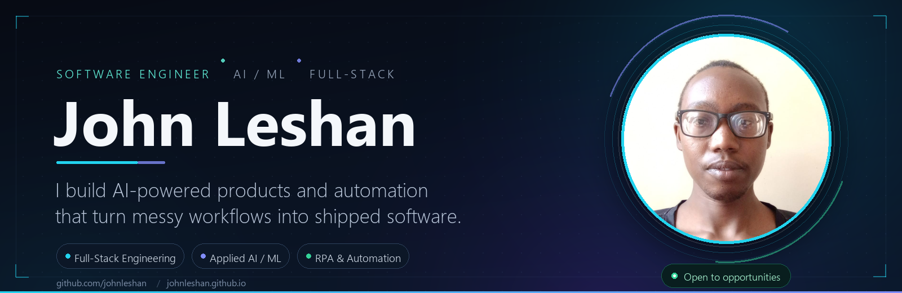
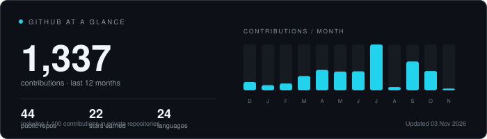
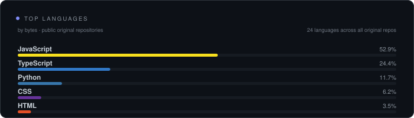

  

  &nbsp;
  &nbsp;
  &nbsp;
  

> **🤖 Applied AI & ML** — RAG assistants, semantic search, document intelligence and forecasting. Evaluated honestly, then shipped.

> **🧱 Full-Stack Products** — React and Next.js front ends, Python and Node APIs, auth, Postgres, Docker and deployment that holds up.

> **⚙️ Automation & RPA** — Playwright workflows, WhatsApp, SMS and USSD channels — removing the repetitive work in between.

I'm a software engineer based in **Kenya**, building where applied AI meets real operations — the kind of software that has to work on a Monday morning, not just in a demo.

My favorite problems have messy inputs: a funder call trapped in a PDF, a clinic with no remote monitoring, a spreadsheet quietly running a business. I like turning those into systems with calm interfaces, honest metrics and automation underneath.

Two years in, I've shipped across web, mobile and messaging channels. I care about evidence over hype, and about the details users feel but never notice.

> **Now:** building the NFL Big Data Bowl 2027 tracking analysis and an AI assistant inside TrackSimply — while going deeper into agentic RAG and sports analytics.

  🎓 B.Sc. Computer Science &nbsp;·&nbsp; 💼 2+ years shipping software &nbsp;·&nbsp; 📍 Kenya &nbsp;·&nbsp; 🌍 Open to remote

<table width="100%">
  <tr>
    <td width="100%">
      <strong>🧬 Languages</strong> 
      
      
      
      
      
    </td>
  </tr>
  <tr>
    <td width="100%">
      <strong>🎨 Frontend</strong> 
      
      
      
      
      
    </td>
  </tr>
  <tr>
    <td width="100%">
      <strong>⚙️ Backend & Data</strong> 
      
      
      
      
      
      
    </td>
  </tr>
  <tr>
    <td width="100%">
      <strong>🧠 AI & ML</strong> 
      
      
      
      
      
      
    </td>
  </tr>
  <tr>
    <td width="100%">
      <strong>🚀 Infrastructure & Automation</strong> 
      
      
      
      
      
      
    </td>
  </tr>
</table>

<table width="100%">
  <tr>
    <td width="100%">
      <h3>🧾 <a href="https://github.com/johnleshan/TrackSimply">TrackSimply</a></h3>
      
AI bookkeeping and business analytics for SMEs — transactions, debts, budgets, inventory and fleet in one calm dashboard. The assistant previews every change before it writes.

      
<b>React · Vite · PostgreSQL · Supabase · Vercel</b>

      

        &nbsp;
        
      

    </td>
  </tr>
  <tr>
    <td width="100%">
      <h3>🔍 <a href="https://github.com/johnleshan/Plagiarism-Detector-Using-Sentence-Transformers">Plagiarism Detector</a></h3>
      
Semantic plagiarism detection with sentence embeddings. Catches paraphrasing, not just copy-paste, across 100+ languages — with a desktop GUI and quantitative similarity scores.

      
<b>Python · Sentence Transformers · PyTorch · Tkinter</b>

      

        
      

    </td>
  </tr>
  <tr>
    <td width="100%">
      <h3>📦 <a href="https://github.com/johnleshan/Warehouse-Management">Warehouse Management</a></h3>
      
An AI warehouse control tower: inventory, receiving and outbound, worker efficiency, burn-rate reports, reorder points and stockout forecasting.

      
<b>Next.js · TypeScript · shadcn/ui · Recharts · MongoDB</b>

      

        &nbsp;
        
      

    </td>
  </tr>
  <tr>
    <td width="100%">
      <h3>⚡ <a href="https://github.com/johnleshan/SwiftChat">SwiftChat</a></h3>
      
Real-time messaging with AI-generated replies and a focus mode that filters conversation noise. Built for speed, dark mode and mobile from day one.

      
<b>Next.js · TypeScript · Genkit · Firebase · shadcn/ui</b>

      

        &nbsp;
        
      

    </td>
  </tr>
</table>

**Also worth a look**

- **[Apex News App](https://github.com/johnleshan/Apex-News-App)** — Android, Kotlin, clean architecture
- **[ChickenTrack](https://github.com/johnleshan/ChickenTrack)** — poultry operations, React + Postgres
- **[Son-Designs](https://github.com/johnleshan/Son-Designs)** — editorial Next.js site
- **[tokenator](https://github.com/johnleshan/tokenator)** — Gemini context-window analyzer

- **🛰️ CubeSat Hackathon 2026** — onboard image prioritisation for a 6U CubeSat. **0.998 priority recall** with a full pipeline and mission-control dashboard.
- **🏙️ Hack4Dev DSRH 2026** — building-age prediction from satellite imagery, transferred Madrid → Amsterdam. **0.763 macro-F1** on a 200-label budget (organizer baseline: 0.615).
- **🎯 Zindi Skills2Job** — job-skills prediction. **15th of 6,500** participants.
- **🏈 Kaggle NFL Big Data Bowl 2027** — physics-first analysis of 10 Hz combine tracking data; currently in progress.

Client and institutional work. The code stays private — the architecture is fair game in a conversation.

- **🏥 Tele-rehabilitation platform** — 3D pain mapping, clinician alerts, bilingual patient experience and a mobile build. Node, PostgreSQL, Socket.IO, Capacitor.
- **🎓 University document intelligence** — RAG chat with OCR and reranking, role-based access and two-tier approvals. FastAPI, Qdrant, MinIO, PostgreSQL, Docker.
- **📝 Grant & publication generator** — funder-call analysis, multi-model LLM routing, dataset analysis and formatted DOCX export. FastAPI, Next.js, pandas.
- **🏭 Predictive maintenance** — XGBoost failure prediction with WhatsApp, SMS and USSD alerts designed for low-connectivity environments.

  

  

Activity cards are generated from the GitHub API. A large share of my recent work lives in private repositories.

  I'm open to software engineering and AI roles, and always up for a good technical conversation. 
  If you're building something ambitious in AI, data or automation — my inbox is open.

  &nbsp;
  &nbsp;
  

📍 Kenya &nbsp;·&nbsp; 🌍 Open to remote &nbsp;·&nbsp; 🕐 EAT (UTC+3)

   
  Thanks for stopping by. — John

